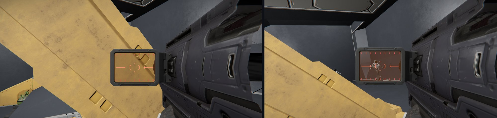
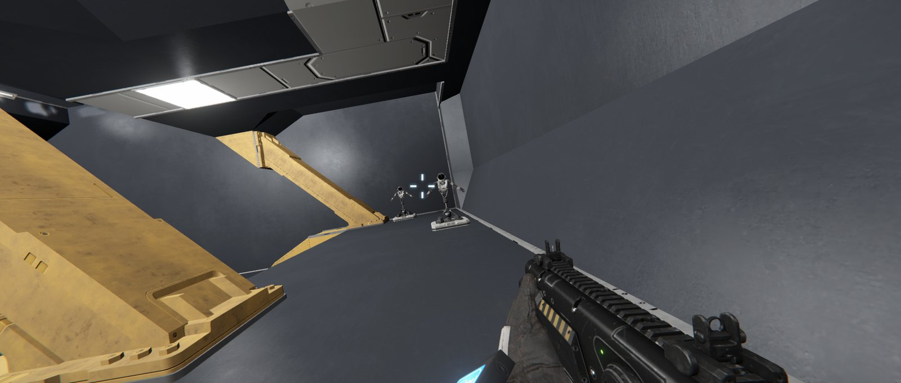
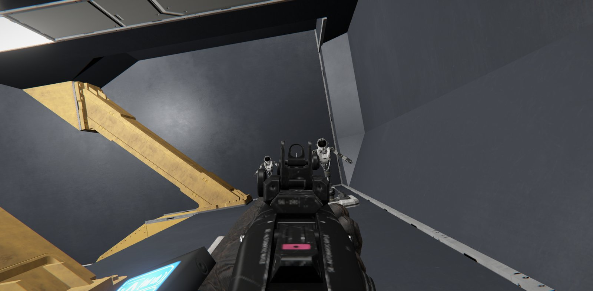
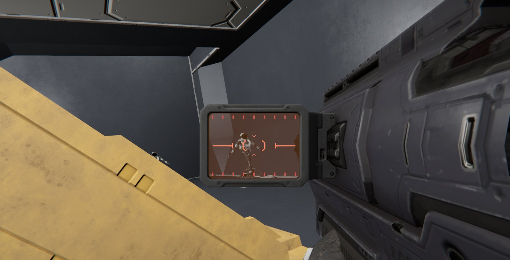
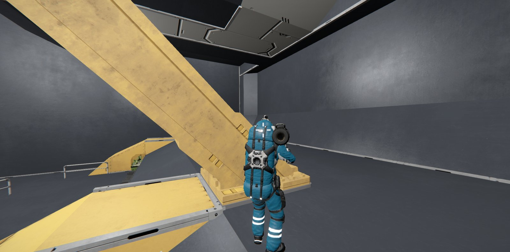

# Polar's ADS Lean

Rainbow Six style leaning on foot for Space Engineers PvP. Client plugin for [Pulsar](https://github.com/SpaceGT/Pulsar).

*Left: behind cover. Right: holding E, the side-step clears the beam and the target is in the sights.*

**Multiplayer:** no server install. The lean is normal strafe input, which the game already sends to the server. Hits and movement stay server-authoritative exactly as in vanilla.

## What it does

- Hold **Q** or **E** to lean left or right.
- The lean is a real short side-step made with the strafe input. The server and other players see you lean out, your hitbox and gun move with you, and shots go where you aim.
- The first-person camera and gun tilt with the lean. The aim point does not move.
- Stops at walls. Let go and you step back to where you started.
- Walk sideways while holding the lean to keep it. Letting go always straightens you up, walking or not.
- Works standing and crouching. The lean holds through jumps and bumps on uneven ground.
- Movement is measured relative to what you stand on, so it works on moving and turning ships.

## Screenshots

| | |
|---|---|
|  |  |
| Leaning right with the rifle. The camera and gun tilt; the crosshair stays on target. | Aiming down sights while leaning. |
|  |  |
| Launcher scope while leaning round cover. | Third person: the real side-step other players see. |

## Where it works

| Game | Works |
|---|---|
| Offline | yes |
| Hosting a multiplayer game | yes |
| Joining a hosted game or dedicated server | yes, no server plugin or mod needed |

The plugin only presses strafe for you, exactly like tapping A or D. It cannot do anything a player cannot do by hand.

## Where it is off

Jetpack, ladders, seats, remote controls, turrets and cameras. Q and E keep their vanilla roll there. Entering any of these ends the lean where you are.

## Keys

Q and E are the vanilla roll keys, which do nothing on foot without the jetpack. Lean keys can be rebound to any key, with Ctrl, Alt or Shift if wanted. A plain binding still works while holding Shift to sprint.

## Settings

Pulsar plugin list > Polar's ADS Lean > Settings.

| Option | Default | Range |
|---|---|---|
| Enabled | on | |
| Lean left / Lean right | Q / E | any key, optional Ctrl / Alt / Shift |
| Toggle lean | off | off = hold to lean |
| Lean distance (m) | 0.5 | 0.2 to 0.8 |
| Camera tilt (degrees) | 10 | 0 to 20, 0 = no tilt |

Saved to `%AppData%\SpaceEngineers\Storage\PolarsADSLean.cfg`, created with the defaults on first run. A damaged file is ignored (defaults are used) and left in place. Delete it to reset.

## Compatibility

- Works alongside [Polar's ADS Improvements](https://github.com/Po11arr/AdsSensitivity), which also patches `MyCharacter.MoveAndRotate` but only changes mouse rotation.
- No shared patch targets with Head Tracking, HeadTrackingPlus, Scrollable FOV, No Forced Camera Zoom or Viktor Ferenczi's plugins. Head tracking rotates the camera on top of the tilted view.

## Known issues

- Third person gets the side-step but no camera tilt.
- If the server corrects your position while you lean (lag), the step back can end a few centimetres off.

## How it works

Four Harmony patches, all for the local player only:

| Target | Patch | Does |
|---|---|---|
| `MyCharacter.MoveAndRotate(Vector3, Vector2, float)` | prefix | Injects strafe input until the character has moved the lean distance, measured from its real position each frame |
| `MyGuiScreenGamePlay.MoveAndRotatePlayerOrCamera()` | prefix, finalizer | Runs the lean only inside the player's input step, once per frame on the main thread. Ends the lean when you take control of a seat, remote control, turret or camera |
| `MyCharacter.GetViewMatrix()` | postfix | Rolls the first-person view around its forward axis |
| `MyCharacterWeaponPositionComponent.UpdateGraphicalWeaponPosition()` (private) | postfix | Rolls the first-person gun model with the view |

Every patch is guarded: an unexpected error writes one line to the game log, prefixed `[PolarsADSLean]`, and turns the lean off until the game restarts. If a patch target is missing after a game update, the plugin removes its own patches and stays off. No networking, and no file access beyond its own config.

## Bug reports

[Open an issue](https://github.com/Po11arr/PolarsADSLean/issues) with your Pulsar `info.log` (`%AppData%\Pulsar\Legacy\info.log`), the `[PolarsADSLean]` lines from the game log (`%AppData%\SpaceEngineers\SpaceEngineers_*.log`), and what you were doing.

## Development

Built on the [CometWorks client plugin template](https://github.com/CometWorks/client-plugin-template). The plugin source is in `PolarsADSLean`. Pulsar compiles it from source; Harmony comes from Pulsar and nothing is bundled.
